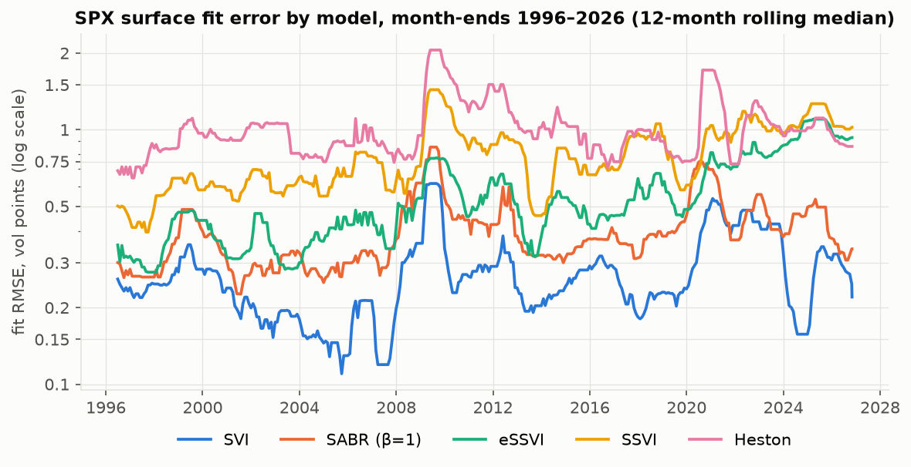
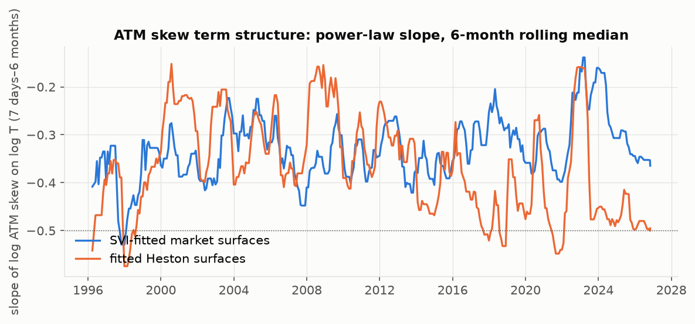

# 02 · Volatility surface models compared

Five models fitted the same way to the same SPX quotes on every month-end from January 1996 to October 2026, plus
3 November 2026 (371 dates; OptionMetrics to August 2025, Cboe after), then stressed with resampled quotes, held-out
expiries and held-out wings. Scripts: `scripts/surface_panel.py`, `scripts/surface_sensitivity.py`,
`scripts/rough_study.py`. Tables: `results/surfaces/`.

**Inputs per date.** AM-settled standard-cycle expiries with 7 days to 3 years left (the one expiry family that
exists throughout 1996-2026; median 10 expiries and 561 quotes per date), out-of-the-money quotes with two-sided
markets and forward |delta| ≥ 1%, implied vols from our parity forwards (report 01). Every model is scored on
model-minus-mid vol (vol points) and on the share of quotes it puts inside the bid-ask.

## The models

| Model | Parameters | Fitted how | Static arbitrage |
|---|---|---|---|
| SVI (raw) | 5 per expiry | quasi-explicit start + SLSQP with butterfly and Lee constraints on a wide grid; calendar order imposed where cheap | free only where constraints hold |
| SABR, β = 1 | 3 per expiry | least squares on Hagan's lognormal formula; expiries joined linearly in total variance | not guaranteed |
| eSSVI | 3 per expiry | slice by slice under the closed-form sufficient conditions | free everywhere by construction |
| SSVI (power law) | 3 + one ATM variance per expiry | one joint fit | free everywhere by construction |
| Heston | 5 in total | joint least squares (COS pricing during calibration, adaptive quadrature for the reported errors) | free (a consistent model) |
| Local vol (Dupire) | none of its own | derived from any of the above: σ²_LV = ∂w/∂T / g(k, T) | valid only where the parent surface is arbitrage-free |

## Results

| Model | Median RMSE (vol pts) | 90th pct | Inside bid-ask (median date) | Butterfly violations, extrapolated | Calendar violations, extrapolated | Local variance valid | Seconds per date |
|---|---:|---:|---:|---:|---:|---:|---:|
| SVI | **0.24** | 0.52 | **89%** | 0.06% | 8.2% | 95.5% | 6.6 |
| SABR | 0.37 | 0.66 | 70% | 0% | 3.1% | 98.8% | 0.25 |
| eSSVI | 0.52 | 0.99 | 63% | 0% | 0% | 100% | 0.50 |
| SSVI | 0.78 | 1.24 | 41% | 0% | 0% | 100% | 0.18 |
| Heston | 0.97 | 1.65 | 26% | 1.2% (numerical) | 0.7% | 97.9% | 11.7 |

Violation shares are of grid points (k from −1.5 to 0.6 at every expiry and two points between expiries); none of the
models violates butterfly arbitrage inside the quoted range. SVI's constraints were all met on 56% of dates: on the
rest at least one slice ended marginally infeasible and was kept as the best nearly-feasible fit, which is where its
extrapolated calendar crossings come from.

**By maturity** (median RMSE, vol points). Every model is worst at the short end, and the ranking holds at every
maturity except that eSSVI overtakes SABR beyond a year:

| | SVI | SABR | eSSVI | SSVI | Heston |
|---|---:|---:|---:|---:|---:|
| ≤ 30 days | 0.37 | 0.53 | 0.91 | 1.37 | 1.96 |
| 31-91 days | 0.23 | 0.29 | 0.51 | 0.67 | 0.79 |
| 92-365 days | 0.18 | 0.30 | 0.38 | 0.53 | 0.62 |
| > 1 year | 0.17 | 0.31 | 0.24 | 0.51 | 0.57 |

**By era.** 2008-2012 and 2020-2026 are hardest for every model; eSSVI degrades most after 2020 (0.37 → 0.90),
when short-dated smiles grew steeper than its three parameters per expiry can follow:

| | SVI | SABR | eSSVI | SSVI | Heston |
|---|---:|---:|---:|---:|---:|
| 1996-2001 | 0.24 | 0.32 | 0.37 | 0.57 | 0.90 |
| 2002-2007 | 0.16 | 0.31 | 0.37 | 0.63 | 0.85 |
| 2008-2012 | 0.30 | 0.47 | 0.59 | 0.92 | 1.31 |
| 2013-2019 | 0.24 | 0.37 | 0.51 | 0.73 | 0.88 |
| 2020-2026 | 0.36 | 0.43 | 0.90 | 1.04 | 1.03 |

**Stress days** (single-date fits, RMSE in vol points): on 24 August 2015, the morning of the flash crash, every
model misses by 2.8-4.9 points; on 10 October 2008 and 16 March 2020 SVI is the only model under 2 (1.47, 1.84).
Calm dates such as 30 June 2017 (SVI 0.19, SABR 0.27) are the opposite extreme.

**Heston parameters** across the 371 dates: median κ 3.5, θ 0.055, σ (vol of variance) 1.16, ρ −0.71, Feller
ratio 0.32 (never above 1: the fitted variance process always reaches zero). σ ranges 0.34-3.4 and κ hits its bound
of 20 on some dates: one diffusive factor cannot match short- and long-dated skews at once.

## Sensitivity to input data (8 dates, 1998-2026)

| | Noise: s.d. of fitted vol when mids are redrawn inside the bid-ask (vol pts) | | Held-out expiry RMSE | Wing extrapolation (fit on \|Δ\| ≥ 10%, score 1-10% Δ) | |
|---|---:|---:|---:|---:|---:|
| | 30-day, k = −0.2 | 30-day ATM | | RMSE | bias |
| SVI | 0.090 | 0.014 | **0.32** | 0.99 | −0.25 |
| SABR | 0.046 | 0.022 | 0.41 | **0.94** | −0.11 |
| eSSVI | 0.031 | 0.014 | 0.58 | 1.54 | −0.72 |
| SSVI | 0.027 | 0.009 | 0.67 | 1.76 | −0.77 |
| Heston | 0.032 | 0.008 | 0.71 | 2.22 | −0.88 |

SVI's flexibility shows up as the largest response to quote noise in the short-dated put wing (three times eSSVI's),
yet it still interpolates held-out expiries best. Every model understates wing vols when it does not see them
(negative bias); SABR's wings, set by its vol-of-vol, extrapolate best.

## SPY, QQQ and IWM

Fitted on month-end chains on five dates each (2018-2025) with the same code. These are American options; the fits
use European-equivalent vols of out-of-the-money quotes, which overstate put vols by the early-exercise premium
(small for short-dated out-of-the-money puts, larger for long-dated ones and at high rates). Median RMSE (vol points):

| | SVI | SABR | eSSVI | SSVI | Heston |
|---|---:|---:|---:|---:|---:|
| SPY | 0.35 | 0.92 | 1.07 | 1.34 | 1.27 |
| QQQ | 0.46 | 0.59 | 1.06 | 1.17 | 1.43 |
| IWM | 0.34 | 0.91 | 1.20 | 1.46 | 1.61 |

The ordering matches SPX; all models do worse than on SPX (wider ETF spreads put fewer quotes inside; the
European approximation adds error to the puts).

## Rough volatility (advanced extension)

Rough models predict an at-the-money skew that scales like T^(H−1/2) with H well below ½. On the 371 SVI-fitted SPX
surfaces the slope of log ATM skew on log T (7 days to 6 months) has median −0.33 (interquartile −0.39 to −0.27; the
power law fits with median R² 0.99), an implied H of about 0.17, in the range the literature reports. **But fitted
Heston surfaces produce the same slope over these maturities (median −0.38):** with a fast mean reversion (κ ≈ 3.5)
Heston's skew decays over a week to six months in a way a power law describes equally well. The two separate only
below a week, which the standard-expiry panel deliberately excludes, so the panel does not discriminate between them.

A rough Bergomi Monte Carlo pricer (exact Cholesky simulation) is in `voldesk.surface.rough`. A coarse calibration
(flat forward variance, 60-point grid, 8,000 paths) on two dates fitted the short-dated smiles worse than Heston
(2.6 vs 1.2 vol points on 30 June 2017, 6.7 vs 2.0 on 31 March 2020). A fair test needs a forward-variance curve
and a proper optimiser; it is listed as future work, not counted as a result for either model.

## Practical strengths and weaknesses

* **SVI** fits closest and interpolates best, and is the right choice for marking and interpolating quotes inside
  the quoted range. Its extrapolated wings are where its arbitrage lives (8% of extrapolated calendar grid points),
  so anything that integrates over the whole surface (local vol, variance swaps, densities) needs care with it.
* **SABR (β = 1)** is the best compromise for a desk: second on fit, best on wing extrapolation, cheap (0.25 s per
  date), parameters with trading meaning (ρ = skew, ν = curvature). It is a per-expiry model with no guarantee
  across expiries.
* **eSSVI** is the right input for local volatility and anything that must be arbitrage-free everywhere: zero
  violations on 371 dates, at the price of roughly twice SVI's error and a short end it cannot follow since 2020.
* **SSVI** buys global consistency with very few parameters and pays for it in fit (41% inside the bid-ask).
* **Heston** is a dynamic model, not an interpolator: worst fit, most stable parameters under quote noise, and the
  only one here that prices path-dependent products consistently. Its short-dated skew is too flat and its
  vol-of-variance is far above Feller's bound.
* **Local vol** inherits every flaw of its parent surface: 95.5% of the SVI grid gives a valid local variance, 100%
  of the eSSVI and SSVI grids.

Local-stochastic volatility was not implemented in this version.
