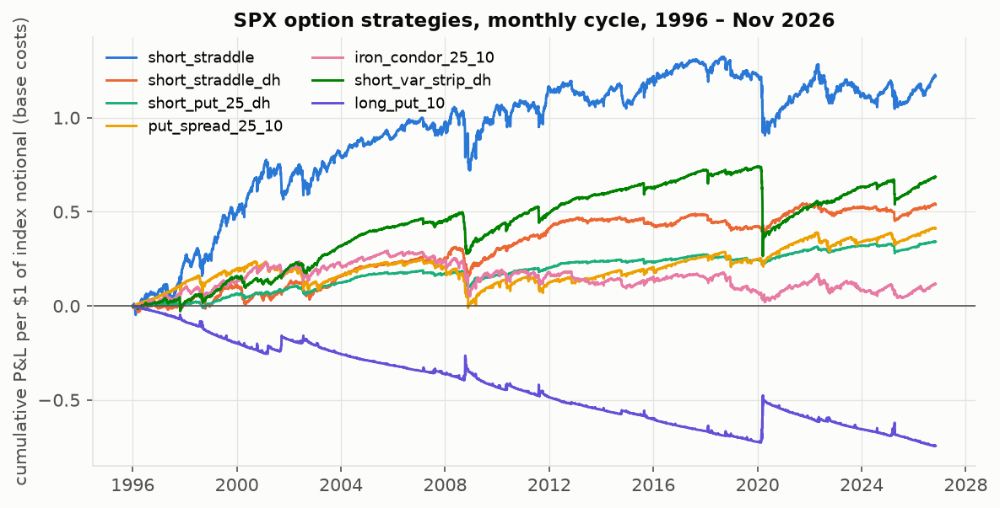
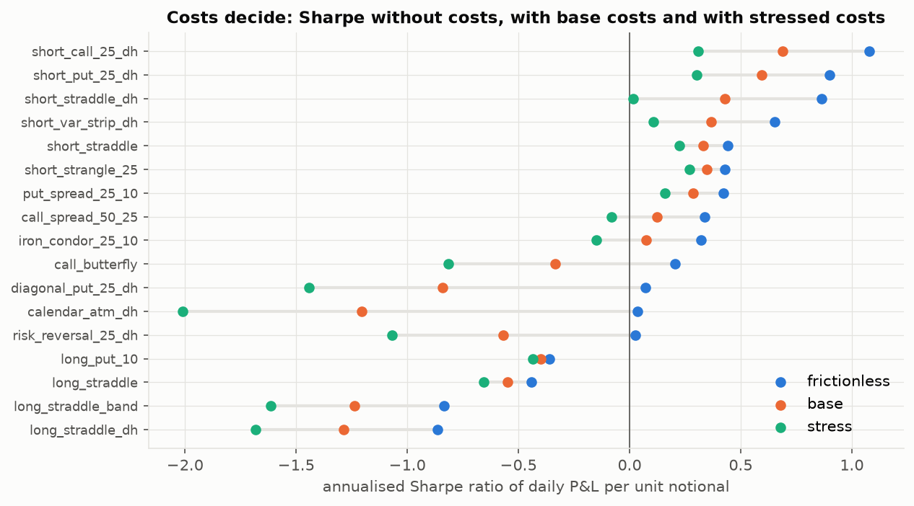
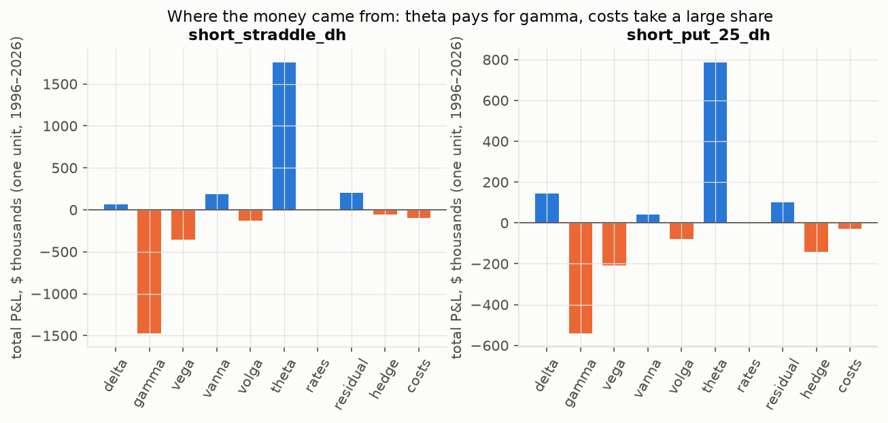

# 03 · Option strategies backtested on SPX, 1996 - November 2026

Seventeen structures, each rolled monthly on real end-of-day quotes (OptionMetrics to 29 August 2025, Cboe to
3 November 2026), marked to market every day, with Greek P&L attribution, three cost models, margin at entry and
stress episodes. Engine: `voldesk.backtest.engine`; library: `voldesk.backtest.library`; run:
`scripts/run_backtests.py` then `scripts/summarize_backtests.py`. Tables: `results/backtests/`.

**These are historical simulations with estimated costs. They describe what the structures did; they are not
evidence of a tradable edge.** No parameter was tuned on these results: strikes, maturities and hedging rules were
fixed before the run, and every structure that was run is reported.

## How the backtest works

* **Cycle.** Each strategy holds one position. At the close of the last trading day before each AM settlement (the
  Thursday before the third Friday) it closes everything and opens the next position, so no settlement price is
  needed. Entry expiry: the standard monthly closest to 30 days out (at least 14). 371 cycles per strategy.
* **Strikes** by forward delta at the out-of-the-money implied vol of each strike (put-call parity makes the in- and
  out-of-the-money vols equal; deep in-the-money quotes are often stale), at the money, or by moneyness.
* **Marks** are mids. A contract with no row on a day is marked at Black-76 with its previous vol and that day's
  forward, and counted: 5-34 such days per strategy over 7,759 days, 225 for the 100+-leg variance strip.
* **Hedging** ('dh') rebalances to zero delta at every close with a futures-like position on the near expiry's
  forward; 'band' rebalances only when |delta| exceeds 10 deltas per straddle.
* **Costs.** Base: half the quoted half-spread per option trade plus $1 per contract, 1 bp per hedge trade. Stress: the
  full half-spread, 2 bp. Frictionless: zero. Trades do not depend on costs, so one run gives all three.
* **Normalization.** Daily P&L divided by the previous close × 100 (the index notional of one unit). Drawdowns are on
  the cumulative sum of these returns, so a long-premium strategy can show drawdowns beyond 100% over 30 years.
* **Margin** at entry under the Cboe/FINRA strategy-based rules (15%/10% for a broad index; defined-risk structures
  at their maximum loss; calendars at the net debit).

## Results (base costs unless stated)

| Strategy | Return/yr, frictionless | Return/yr | Vol/yr | Sharpe | Sharpe, stress | Max drawdown | Worst day | Median margin ($) | Win rate |
|---|---:|---:|---:|---:|---:|---:|---:|---:|---:|
| short_straddle | 5.3% | 4.0% | 12.0% | 0.33 | 0.22 | −42% | −10.5% | 27,374 | 61% |
| short_strangle_25 | 4.1% | 3.4% | 9.6% | 0.35 | 0.27 | −34% | −10.5% | 19,533 | 71% |
| long_straddle | −5.3% | −6.6% | 11.9% | −0.55 | −0.66 | | −11.5% | 5,985 | 35% |
| long_put_10 | −2.2% | −2.4% | 6.0% | −0.40 | −0.43 | | −10.1% | 530 | 5% |
| short_straddle_dh | 3.5% | 1.8% | 4.1% | 0.43 | 0.01 | −16% | −4.8% | 27,374 | 64% |
| short_var_strip_dh | 4.0% | 2.2% | 6.1% | 0.37 | 0.11 | −48% | −15.3% | 86,672 | 78% |
| long_straddle_dh | −3.5% | −5.2% | 4.0% | −1.29 | −1.68 | | −2.5% | 5,985 | 26% |
| long_straddle_band | −3.4% | −5.1% | 4.1% | −1.24 | −1.61 | | −2.5% | 5,985 | 26% |
| put_spread_25_10 | 2.0% | 1.3% | 4.7% | 0.28 | 0.16 | −26% | −6.2% | 6,425 | 86% |
| call_spread_50_25 | 1.7% | 0.6% | 5.1% | 0.12 | −0.08 | −37% | −2.6% | 1,940 | 50% |
| iron_condor_25_10 | 1.6% | 0.4% | 4.9% | 0.08 | −0.15 | −27% | −6.4% | 5,663 | 65% |
| call_butterfly | 1.1% | −1.8% | 5.3% | −0.34 | −0.82 | −86% | −2.9% | 3,393 | 47% |
| risk_reversal_25_dh | 0.0% | −1.0% | 1.7% | −0.57 | −1.07 | −33% | −1.3% | 18,893 | 43% |
| calendar_atm_dh | 0.0% | −1.5% | 1.2% | −1.21 | −2.01 | −47% | −2.7% | 1,395 | 28% |
| diagonal_put_25_dh | 0.1% | −0.9% | 1.1% | −0.84 | −1.44 | −31% | −1.2% | 19,675 | 30% |
| short_put_25_dh | 1.7% | 1.1% | 1.9% | **0.59** | 0.30 | −9% | −2.0% | 18,118 | 74% |
| short_call_25_dh | 1.6% | 1.0% | 1.5% | **0.69** | 0.31 | −4% | −1.5% | 18,044 | 62% |

### What the table says

1. **Selling index volatility earned a premium before costs**: every short-volatility structure is positive
   frictionless (short straddle +5.3% of notional a year, Sharpe 0.44), and every long one negative. The premium is
   paid as crash losses: the short straddle's worst day is −10.5% of notional and its worst cycle lost 1.5 times its
   margin.
2. **Costs decide almost everything else.** Base costs (option spreads plus daily hedge trades) halve the hedged
   short straddle's return (3.5% → 1.8% a year) and stressed costs take it to zero (Sharpe 0.01). Structures with little net premium (butterfly, calendar,
   diagonal, risk reversal) are near zero before costs and clearly negative after: their costs are 3-15 times their
   gross P&L.
3. **The best risk-adjusted results are the delta-hedged short 25-delta options** (Sharpe 0.59 and 0.69 at base
   costs, 0.30-0.31 stressed): most of the variance premium for a fraction of the gamma, and less hedging turnover
   than an at-the-money straddle.
4. **Hedging frequency barely matters for long gamma**: hedging only when delta exceeds 10 deltas gives the same
   result as hedging daily (−5.1% vs −5.2% a year), consistent with hedging theory (the expected P&L of a hedged
   option does not depend on rebalancing; costs and variance do).
5. **Vertical spreads and condors keep a small premium** before costs (1.6-2.0%) that base costs mostly remove.

## Where the P&L came from

Daily Taylor attribution of each leg's mid change in its forward, own implied vol, time and discount factor (the
leg's own vol when defined on both days, else the out-of-the-money vol at its strike; the residual is everything
the second-order expansion misses):

For the hedged short straddle, theta (+$1.76m per unit over 30 years) pays for gamma (−$1.47m) and vega (−$0.36m:
implied vol rose against the short); costs took $95k. The residual is large relative to the net result and comes
from crash days, where third- and higher-order moves dominate: a second-order expansion explains a calm day to within
a few percent and a 10% day much less well. This is reported as it is, not forced to zero.

## Stress episodes (cumulative P&L per unit notional, base costs)

| Episode | short_straddle | short_straddle_dh | short_var_strip_dh | long_put_10 | put_spread_25_10 | iron_condor_25_10 | short_put_25_dh |
|---|---:|---:|---:|---:|---:|---:|---:|
| LTCM 1998 | −4.7% | −3.2% | −2.6% | −1.6% | −5.6% | −4.0% | −2.0% |
| Lehman 2008 | −26.7% | −12.7% | −20.6% | +5.3% | −18.0% | −16.6% | −7.7% |
| Downgrade 2011 | −10.2% | −1.6% | −6.3% | +5.9% | −4.4% | −3.4% | −1.8% |
| Volmageddon 2018 | −5.6% | −2.2% | −4.7% | +3.1% | −2.3% | −1.9% | −1.5% |
| COVID 2020 | −25.0% | +1.0% | −34.5% | +22.9% | −4.6% | −3.0% | −0.4% |
| Tariffs 2025 | −9.6% | −3.6% | −7.2% | +5.8% | −2.9% | −2.7% | −2.5% |

**Path dependence, not a bug:** the hedged short straddle ended the COVID window slightly positive. Checked day by day:
it lost on gamma in the first days of the fall (Feb 24-27, 2020), then the put went so deep in the money that its
gamma collapsed and the daily hedge offset the moves; the cycle lost 2.3% of notional, and the next cycle opened at
an implied vol near 70% and earned part of it back as vol fell. The variance strip, whose 1/K² weights keep short
far out-of-the-money puts, lost the most (−34.5%): a short variance swap loses quadratically in a crash.

## Portfolio-level risk

`results/backtests/correlation_base.csv` gives the daily correlation of all 17 strategies, `episodes_base.csv` the
episode table above for every strategy, and `voldesk.strategies.risk` computes book-level Greeks, spot × vol grids,
historical-scenario P&L (index and ATM-vol moves at five tenors from the standardized surface) and VaR/ES by full
revaluation for any combination of positions; the demo exposes the same calculations interactively.

## Limits

* Mid marks and an assumed share of the spread; real fills, especially for 100-leg strips and in crashes, may be worse.
* One position per strategy and monthly entries only; no intramonth risk management or stop-losses.
* AM-settled standard monthlies only (no weeklies), closed before settlement.
* Hedges are futures-like with no financing or margin cost; the 6%-of-notional hedge margin is reported only.
* The splice from OptionMetrics to Cboe on 2 September 2025 carries a small vendor difference (report 01).
