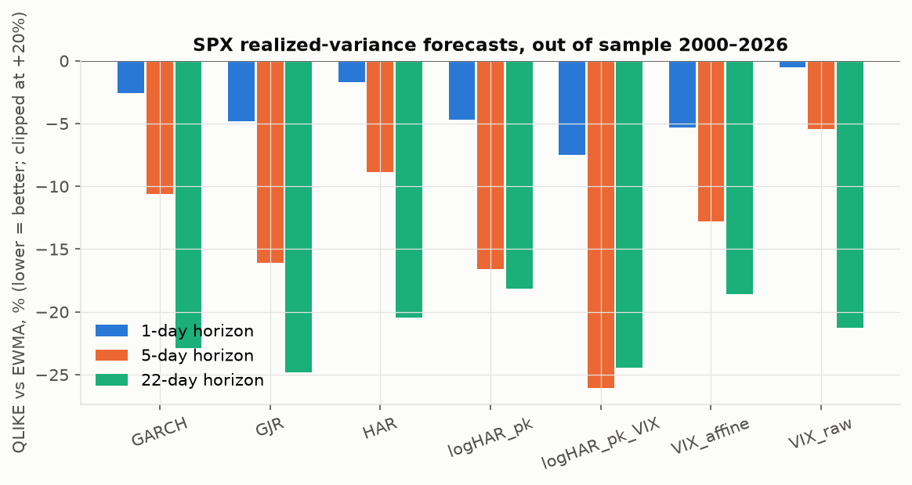
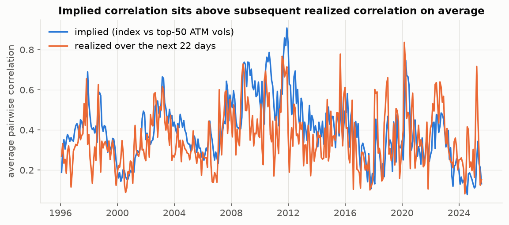

# 04 · Forecasting volatility, vol of vol, implied vol, correlation and regimes

Every forecast is out of sample: expanding training windows refitted every 21 trading days (GARCH every 126), and a
training row is used only once its target has been observed at the refit date. Simple baselines are always in the
comparison. Losses: QLIKE (Patton's form, reported as % change against EWMA) for variances, squared error and
out-of-sample R² against the random walk for levels, Brier score / log loss / AUC for probabilities; Diebold-Mariano
tests (Newey-West, lags ≥ horizon) and the model confidence set of Hansen, Lunde & Nason at 10%. Scripts:
`scripts/forecast_study.py`, `scripts/forecast_economics.py`; tables in `results/forecast/`.

## 1. Realized variance of the S&P 500 (out of sample 2000-2026)

Target: mean daily squared log return over the next 1, 5, 22 days.

| Model | 1 day | 5 days | 22 days |
|---|---:|---:|---:|
| GARCH(1,1) | −2.6% | −10.6% | −22.9% ◦ |
| GJR-GARCH | −4.8% | −16.1% | −24.8% ◦ |
| HAR (squared returns, levels) | −1.7% | −8.9% | −20.4% |
| log-HAR (Parkinson range) | −4.7% | −16.6% | −18.1% ◦ |
| **log-HAR (Parkinson) + VIX** | **−7.5% ◦** | **−26.0% ◦** | −24.5% ◦ |
| HAR + VIX² (levels) | +52.8% | +402.6% | −24.6% ◦ |
| VIX² (affine) | −5.3% | −12.8% | −18.6% ◦ |
| VIX² (raw) | −0.5% | −5.5% | −21.3% ◦ |

QLIKE relative to EWMA (negative = better); ◦ = in the 10% model confidence set. log-HAR + VIX is the only member of
the set at 1 and 5 days (DM t = 8.6 and 8.4 against EWMA); at 22 days seven models are statistically tied. The level
regression with VIX² is the trap: it occasionally forecasts near its floor in calm markets, where QLIKE punishes it
without limit; in logs the same information is the best forecaster.

## 2. Vol of vol (VIX daily changes, out of sample 2008-2026)

| Model | 5 days | 22 days |
|---|---:|---:|
| HAR (squared log changes) | −15.1% | −38.7% ◦ |
| log-HAR (VIX daily range) | −17.5% ◦ | **−40.7% ◦** |
| log-HAR (range) + VIX-option implied vol | **−20.5% ◦** | −40.0% ◦ |
| VIX-option implied vol (affine) | −18.4% ◦ | −39.5% ◦ |
| VIX-option implied vol (raw) | +33.1% | +77.7% |

The raw 30-day implied vol of VIX options (OptionMetrics standardized options on the VIX) averages 83% while the
realized vol of the VIX over the next 22 days averages 112%: VIX options are priced off VIX futures, which move less
than the spot index, so used raw they are a biased forecast of spot-VIX vol; recalibrated (affine) they are as good
as the best HAR.

## 3. Implied volatility (the VIX level, 1-22 days ahead)

| Model | R² vs random walk, 1 day | 5 days | 22 days |
|---|---:|---:|---:|
| AR(1) in logs | 1.3% | 4.3% ◦ | **12.3% ◦** |
| HAR in logs | **3.0% ◦** | **5.1% ◦** | 12.2% ◦ |
| HAR + variance premium, past return, term slope | 2.0% ◦ | 1.1% ◦ | 3.6% |
| VIX futures as the forecast (2007-2026) | 0.8% | 0.5% | 5.4% |
| VIX futures, recalibrated (2007-2026) | −9.2% | −4.2% | −1.6% |

(2000-2026 for the first three rows; on the futures sample, 2007-2026, HAR's R² is 8.1%, 4.7%, 13.5%.) Mean
reversion is the whole story: simple AR/HAR models beat the random walk, and the extra predictors make forecasts
worse out of sample. The futures curve, the market's own risk-neutral forecast of the VIX, beats the random walk by
less than AR(1) at every horizon because it contains a risk premium; recalibrating it on past data did not help.

## 4. Correlation (top-50 S&P 500 members, next 22 days, out of sample 2000-2026)

Target: realized equicorrelation of the point-in-time top-50 basket over the next 22 days (see
`voldesk.forecast.correlation`).

| Model | RMSE | R² vs last month's realized | DM t |
|---|---:|---:|---:|
| last 22 days' realized (random walk) | 0.174 | 0 | |
| last 66 days' realized | 0.160 | 15.0% | 2.6 |
| HAR (5/22/66-day realized) | 0.144 | 31.6% | 6.6 |
| implied correlation, raw | 0.166 | 8.4% | 1.3 |
| implied correlation, recalibrated | 0.141 | 34.0% | 5.9 |
| **HAR + implied** | **0.139** | **36.5% ◦** | 7.1 |

Implied correlation (SPX ATM vol against the members' ATM vols, Cboe's formula) averaged 0.396 against 0.359
realized over the following 22 days: a correlation risk premium of +0.04 on average (median +0.04), with a standard
deviation of 0.16, negative when correlation spikes. Combined with realized correlation it is the best forecaster.

## 5. Regime transitions (will the next 22 days' realized vol exceed 25%?)

Base rate 12.0% of days (6.0% of days that start calm). Walk-forward logistic models; the two-state hidden Markov
model is refitted every January on data up to then and contributes its real-time (filtered) probability of the
turbulent state.

| Predictors | Brier (all days) | AUC (all days) | AUC (calm days only) |
|---|---:|---:|---:|
| training-sample base rate | 0.107 | (constant) | (constant) |
| log VIX | **0.066** | 0.882 | 0.784 |
| log realized vol (22 and 5 days) | 0.069 | 0.878 | 0.783 |
| HMM turbulent-state probability | 0.080 | 0.842 | 0.741 |
| log VIX + HMM | 0.067 | **0.884** | 0.790 |
| all of the above | 0.069 | 0.881 | 0.791 |

Turbulent months are well predicted, mostly because turbulence persists. Transitions out of calm markets are harder
(AUC 0.78-0.79), and the HMM adds almost nothing to the VIX.

## 6. Do the forecasts make money after costs?

**Volatility targeting the S&P 500** (exposure = 15% / forecast vol, capped at 2×, 1 bp per unit of exposure traded,
2000-2026, price returns):

| Rule | Return/yr | Vol/yr | Sharpe | Max drawdown | Turnover/yr | Distance of realized vol from 15% |
|---|---:|---:|---:|---:|---:|---:|
| buy and hold | 6.2% | 19.2% | 0.32 | −84% | 0 | 9.7 pts |
| target with EWMA | 5.9% | 15.6% | **0.38** | −65% | 8.3 | 2.2 pts |
| target with GJR | 5.1% | 13.9% | 0.36 | −63% | 8.5 | 2.7 pts |
| target with log-HAR + VIX | 5.0% | 14.4% | 0.35 | −61% | 12.5 | 2.5 pts |
| target with the VIX | 4.2% | 12.0% | 0.35 | −49% | 10.4 | 3.9 pts |

Every forecast turns the index into a steadier, shallower-drawdown exposure with a slightly higher Sharpe ratio. The
statistically best forecaster is not the economically best: log-HAR + VIX trades 50% more than EWMA for no gain.

**Timing the variance premium** (316 monthly cycles of the backtested strategies, 2000-2026, base costs; Sharpe on
cycle returns, 95% bootstrap interval of the difference to "always on"):

| Strategy | Always on | Only if forecast premium > 0 | Sized by forecast premium | Skip if P(turbulent) > 50% |
|---|---:|---:|---:|---:|
| short_straddle_dh | 0.46 | 0.46 | 0.40 [−0.21, +0.11] | 0.36 [−0.26, +0.08] |
| short_straddle | 0.25 | 0.25 | 0.30 [−0.11, +0.20] | 0.12 [−0.25, −0.01] |
| short_strangle_25 | 0.33 | 0.33 | 0.35 [−0.16, +0.19] | 0.18 [−0.27, −0.05] |
| short_put_25_dh | 0.58 | 0.58 | 0.48 [−0.28, +0.09] | 0.47 [−0.25, +0.08] |
| short_var_strip_dh | 0.29 | 0.29 | 0.23 [−0.43, +0.06] | 0.21 [−0.20, −0.01] |

The forecast variance premium (VIX² minus forecast realized variance) was positive at every entry date, so the
"trade only when positive" rule never stood aside; sizing by it did not help reliably; and standing aside in
forecast turbulence made three of five strategies significantly worse, because the richest premia are sold exactly
then. A long/short switch between hedged straddles never called for the long side. **None of the timing rules adds
value after costs; a constant short-volatility allocation is as good as any forecast-driven one tested here.**
